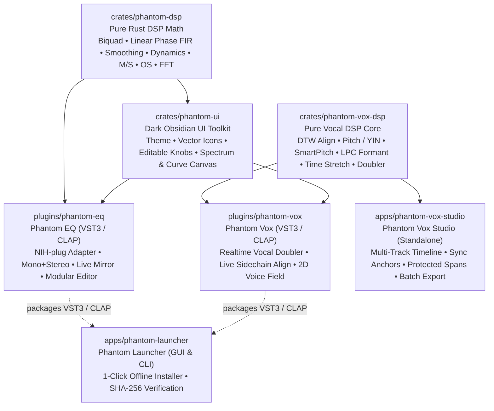

<div align="center">

# PHANTOM DSP SUITE

**Open-Source, Mastering-Grade Audio Plugins & Offline Plugin Hub — Written in Pure Rust**

[](https://github.com/intity01/phantom-dsp-suite/actions/workflows/ci.yml)
[](LICENSE-MIT)
[](https://www.rust-lang.org/)
[](#quickstart-installation)
[](SECURITY.md)

*Precision DSP mathematics. Dark Obsidian aesthetics. Zero telemetry, zero DRM, zero background updaters.*

</div>

---

## Overview

**Phantom DSP Suite** is a clean-room, open-source collection of studio audio plugins and an offline desktop installer built in **Rust** on top of [`nih-plug`](https://github.com/robbert-vdh/nih-plug) and `egui`.

Every plugin in the suite is designed for modern mixing and mastering workflows — combining real-time zero-allocation audio processing, tactile visual feedback, and complete respect for your studio machine:

- **100% Offline & Zero Telemetry** — No accounts, no dongles, no license servers, no analytics, and no automatic background network calls.
- **Cross-Platform Standards** — Native **VST3** and **CLAP** support for Windows, Linux, and macOS DAWs (Cubase, Reaper, Ableton Live, Bitwig Studio, Studio One, FL Studio).
- **Verifiable Integrity** — Official releases ship with `SHA256SUMS.txt`, and `phantom-launcher` verifies installed binaries cryptographically offline.

---

## Architecture

Phantom DSP Suite is structured as a modular Cargo workspace with strict separation between pure signal processing, reusable UI primitives, DAW plugin wrappers, and the desktop launcher:



| Workspace Member          | Crate Type          | Responsibility                                                                  |
| ------------------------- | ------------------- | ------------------------------------------------------------------------------- |
| `crates/phantom-dsp`      | Library (`rlib`)    | Pure audio DSP algorithms — zero UI or host dependencies, fully unit-tested     |
| `crates/phantom-vox-dsp`  | Library (`rlib`)    | Pure vocal DSP engine — DTW alignment, YIN pitch, SmartPitch, formant, doubler  |
| `crates/phantom-ui`       | Library (`rlib`)    | Shared Dark Obsidian (`#101117` / `#38BDF8`) widgets, icons, and spectrum views |
| `plugins/phantom-eq`      | `cdylib` + `rlib`   | Flagship 24-band dynamic parametric equalizer exporting VST3 and CLAP           |
| `plugins/phantom-vox`     | `cdylib` + `rlib`   | Realtime vocal doubler & live sidechain alignment plugin exporting VST3 / CLAP  |
| `apps/phantom-vox-studio` | Binary (`bin`)      | Standalone multi-track vocal alignment studio with timeline, anchors & export   |
| `apps/phantom-launcher`   | Binary (`bin`)      | Cross-platform offline plugin hub & headless CLI installer with SHA-256 checks  |

---

## Flagship Plugin: Phantom EQ (`v0.1.0`)

**Phantom EQ** (`v0.1.0`) is a clean-room 24-band dynamic & spectral parametric equalizer engineered for surgical mixing and transparent mastering:

- **24 Fully Parametric Bands (Clean Pro-Q 4 Empty Startup)** — 10 filter shapes (`Bell`, `Low Cut`, `High Cut`, `Low Shelf`, `High Shelf`, `Notch`, `Band Pass`, `Tilt Shelf`, `Flat Tilt`, `All Pass`) and 8 cascaded slopes (`6` to `96 dB/oct` + `Brickwall`) built on Transposed Direct Form II RBJ biquads.
- **Triple Processing Engine (`Zero Latency + 1x` Low-CPU Default)**:
  - **Zero Latency (Analog IIR)** — Default low-CPU `0`-sample latency mode (`1x` oversampling off by default) for tracking and high-track-count mixing, with `2x HQ` / `4x Mastering` polyphase half-band oversampling available on demand.
  - **Natural Phase (Analog-Matched IIR)** — Zero-latency Vicanek/Orfanidis Nyquist magnitude & phase matching with selectable `1x / 2x / 4x` polyphase oversampling.
  - **Linear Phase (Mastering FIR)** — 4095-tap odd Type-I symmetric Kaiser (β=7.5) FIR kernel inside an 8192-point zero-padded Overlap-Save FFT convolution engine (`HOP_SIZE = 1024`), exact buffer-size-invariant **3071-sample** latency (~64.0 ms @ 48 kHz) reported dynamically to the DAW via `set_latency_samples`, C1 raised-cosine click-free kernel crossfading, and zero heap allocations proven under test.
- **Zero-Click Smoothing & 10 ms PDC-Aligned Bypass**:
  - Per-band `BandParamSmoother` (`16`-sample sub-blocks, log frequency/Q + linear gain) and `OnePoleSmoother` for output gain and global Gain Scale eliminate zipper noise during automation and live drags.
  - `BypassCrossfade` (`10 ms` wet/dry ramp) + `LatencyBypassDelay` (continuously aligned `3071`-sample delay line in Linear Phase mode) ensure click-free, timing-invariant DAW bypass with live meters and spectrum.
- **Native Mono + Stereo Tracks & External Sidechain** — Declares both Stereo (`2->2` + 2-ch `Sidechain`) and Mono (`1->1` + 1-ch `Sidechain`) layouts, processing mono tracks via fixed 256-sample stack buffers with zero heap allocations.
- **Global Gain Scale (`0%–200%`)** — DAW-automatable scaling of band gain, dynamic range, and visual EQ curves for gain-bearing shapes (`Bell`, `LowShelf`, `HighShelf`, `TiltShelf`, `FlatTilt`, `BandPass`) while keeping cuts, notch, and all-pass shapes intact.
- **Per-Band Stereo / Mid-Side / Left-Right Routing & Dynamics** — Independent Stereo, Mid, Side, Left, or Right routing across all modes; soft-knee Dynamic EQ with Attack/Release/Auto-Threshold/External Sidechain, live GR telemetry rings, and zero-latency 9-subband **Spectral Dynamics**.
- **EQ Match, Spectrum Grab & Multi-Instance Collision Detection** — Reference vs. track 1/3-octave curve fitting (`EqMatchEngine`, up to 12 bands), interactive **Spectrum Grab** peak handles, and lock-free 16-slot **Collision Registry** cross-track masking overlay.
- **Character Saturation, Auto-Gain & EBU R128 LUFS Metering** — `Clean`, `Subtle Analog`, and `Warm Tube` saturation, gated RMS Auto-Gain compensation, and ITU-R BS.1770-4 K-weighted Momentary & Short-Term LUFS + True Peak meters.
- **Minimal Pro-Q 4 Dark Obsidian Interface**:
  - **Single-Row Header & Slim Bottom Strip** — Crisp, distraction-free layout with fixed proportional window presets (`S 960×560`, `M 1100×640`, `L 1260×720`, `XL 1420×800`) and lock-free `LiveParamMirror` (0 ms GUI updates even when DAW audio is stopped).
  - **Floating Band HUD & Direct Keyboard Knob Typing** — Anchored `296×98 px` floating HUD with 4 rotary knobs (`FREQ`, `GAIN`, `Q`, `DYN`); click any knob readout to type values directly including 12-TET musical notes (`A4`, `C#3`, `Db4`, `2.5k`), or double-click the dial to reset.
  - **Right-Click Context Menu & Precision Gestures** — Right-click any band node for Bypass, Solo, all 10 shapes, all 8 slopes, all 5 placements, Invert Gain, Dynamic (-4 dB) / Clear Dynamics, Spectral Dynamics, and Delete; middle-click any node for instant 1-click Bypass; hold `Shift + Drag` for `0.15x` fine mode; toggle Piano Roll (`C1..C8`) & `Snap` / `Ctrl`-drag semitone quantization.
  - **Custom User Presets, A/B Compare & 64-Step Undo/Redo** — 12 built-in Factory Presets + named offline `.peq` User Presets (inline naming + `×` deletion), `<` / `>` quick stepping, `[A / B]` comparison slots with `[Copy]`, and 64-step Undo/Redo (`Ctrl+Z` / `Ctrl+Y`).
- **100% Offline & Zero Telemetry** — Zero networking crates linked into the plugin binary.

---

## Vocal Suite: Phantom Vox & Phantom Vox Studio

### Phantom Vox Plugin (`plugins/phantom-vox`)
A clean-room VST3 / CLAP realtime vocal processor inspired by high-end alignment and artificial double-tracking workflows:
- **Triple Operational Modes**:
  - `Doubler` — Zero-latency multi-voice vocal doubler (up to 4 voices) with independent timing offsets, detuning, LPC-derived formant preservation, stereo field spread, and mono compatibility check.
  - `LiveAlign` — Low-latency live monitoring alignment (2048-sample fixed ring delay with DAW PDC) matching incoming dub tracks to an external lead vocal sidechain in real time.
  - `AlignAndDouble` — Cascaded live sidechain alignment feeding the multi-voice doubling engine.
- **Dual Visualizer HUD**:
  - Scrolling Guide sidechain (Cyan) vs. Dub input (Purple) dual-lane waveform monitor with live bipolar `±ms` offset readout.
  - 2D Voice Spread Field visualizer plotting pan positions, pitch detune, and formant variations.
  - Stereo phase correlation meter and bypass flag with zero allocation during audio processing.

### Phantom Vox Studio Standalone (`apps/phantom-vox-studio`)
A standalone offline multi-track vocal alignment workstation built with `eframe` / `egui`:
- **Multi-Track Alignment Timeline** — Multi-lane visualization with layered waveforms (Guide Reference vs Dub Layer).
- **YIN Pitch Contour & Phonetic Badges** — Realtime YIN pitch tracking overlay and phonetic classification badges (`Voiced`, `Sibilance`, `Breath`, `Transient`).
- **Sync Anchors & Protected Regions** — Click-to-pin alignment markers and click-to-lock protected spans (preserving original timing and pitch for natural consonants).
- **Phrase Confidence & Smart Alignment** — Acoustic feature extraction (RMS, spectral flux, ZCR, log-mel, MFCC) and asymmetric DTW alignment with confidence grading.
- **Batch Aligned Export & Non-Destructive Projects** — Instant A/B mix audition, 32-step undo/redo, non-destructive `.pvox` JSON project save/load, and sample-accurate batch aligned WAV export.

---

## Suite Roadmap

| Plugin                  | Category    | Status      | Formats          | Highlights                                                                                           |
| ----------------------- | ----------- | ----------- | ---------------- | ---------------------------------------------------------------------------------------------------- |
| **Phantom EQ**          | Equalizer   | **v0.1.0**  | VST3 / CLAP      | 24-band Dynamic & Spectral EQ, Zero/Natural/Linear Phase, PDC Bypass, Mono+Stereo, Gain Scale & LUFS |
| **Phantom Vox**         | Vocal       | **v0.1.0**  | VST3 / CLAP      | Realtime Vocal Doubler, Live Sidechain Alignment, 2D Voice Field & Dual Waveform Monitor             |
| **Phantom Vox Studio**  | Standalone  | **v0.1.0**  | Standalone App   | Multi-track vocal timeline, Sync Anchors, Protected Regions, YIN Pitch, Batch Aligned WAV Export     |
| **Phantom Comp**        | Dynamics    | Planned     | VST3 / CLAP      | Mastering & bus compressor with visual transfer curve & sidechain filter                             |
| **Phantom Limiter**     | Mastering   | Planned     | VST3 / CLAP      | True Peak brickwall mastering limiter with EBU R128 loudness metering                                |
| **Phantom MB**          | Multiband   | Planned     | VST3 / CLAP      | Linear-phase multiband dynamic processor with per-band soloing                                       |
| **Phantom Saturn**      | Saturation  | Planned     | VST3 / CLAP      | Multiband warmth, tape, and tube harmonic saturation engine                                          |

---

## Quickstart: Installation

### Option 1 — Phantom Launcher (Recommended, Cross-Platform)

Download the latest release archive for your OS from [GitHub Releases](https://github.com/intity01/phantom-dsp-suite/releases), extract it, and run **Phantom Launcher**:

```bash
# Launch the Dark Obsidian Desktop GUI
./phantom-launcher

# Or use the headless CLI for scripted / studio-wide deployment:
./phantom-launcher --cli                  # Inspect catalog, target paths & status
./phantom-launcher --install phantom-eq   # Install VST3 + CLAP to user plugin dirs
./phantom-launcher --verify phantom-eq    # Verify installed binaries via SHA-256
./phantom-launcher --uninstall phantom-eq # Cleanly remove installed plugin files
```

Use `--system` to target system-wide plugin folders, or `--vst3-dir <path>` / `--clap-dir <path>` for custom directories.

### Option 2 — Windows Quick-Install Scripts for Cubase

On Windows, you can also run the included Cubase helper scripts from the repository or extracted archive:

```powershell
# PowerShell (checks if Cubase is running, installs to User or System VST3)
.\install_to_cubase.ps1
```

Or double-click `install_to_cubase.bat` in Windows Explorer.

### Standard DAW Plugin Paths

| OS          | Scope  | VST3 Path                                                     | CLAP Path                                                     |
| ----------- | ------ | ------------------------------------------------------------- | ------------------------------------------------------------- |
| **Windows** | User   | `%LOCALAPPDATA%\Programs\Common\VST3\Phantom EQ.vst3`         | `%LOCALAPPDATA%\Programs\Common\CLAP\Phantom EQ.clap`         |
| **Windows** | System | `%CommonProgramFiles%\VST3\Phantom EQ.vst3`                   | `%CommonProgramFiles%\CLAP\Phantom EQ.clap`                   |
| **macOS**   | User   | `~/Library/Audio/Plug-Ins/VST3/Phantom EQ.vst3`               | `~/Library/Audio/Plug-Ins/CLAP/Phantom EQ.clap`               |
| **macOS**   | System | `/Library/Audio/Plug-Ins/VST3/Phantom EQ.vst3`                | `/Library/Audio/Plug-Ins/CLAP/Phantom EQ.clap`                |
| **Linux**   | User   | `~/.vst3/Phantom EQ.vst3`                                     | `~/.clap/Phantom EQ.clap`                                     |
| **Linux**   | System | `/usr/lib/vst3/Phantom EQ.vst3`                               | `/usr/lib/clap/Phantom EQ.clap`                               |

---

## Building from Source

### Prerequisites

- **Rust** stable toolchain (`edition = "2021"`): install via [rustup.rs](https://rustup.rs/)
- **Linux GUI/OpenGL libraries** (Ubuntu / Debian):
  ```bash
  sudo apt-get update
  sudo apt-get install -y libxcb1-dev libgl1-mesa-dev pkg-config \
    libx11-dev libxcursor-dev libxrandr-dev libxi-dev libxkbcommon-dev
  ```

### Native Build & Test (Linux / macOS / Windows)

```bash
git clone https://github.com/intity01/phantom-dsp-suite.git
cd phantom-dsp-suite

# Run DSP, UI, EQ, and Launcher test suites
cargo test -p phantom-dsp --release -- --nocapture
cargo test -p phantom-ui --release -- --nocapture
cargo test -p phantom-eq --release -- --nocapture
cargo test -p phantom-launcher --release -- --nocapture

# Build Phantom EQ (VST3/CLAP cdylib) and Phantom Launcher
cargo build --release -p phantom-eq -p phantom-launcher
```

### Cross-Compiling Windows Binaries from Linux (`cargo-zigbuild`)

Install the target and linker tooling once:

```bash
rustup target add x86_64-pc-windows-gnu
cargo install cargo-zigbuild
```

Build the Windows VST3/CLAP plugin DLL (exporting `GetPluginFactory` and `clap_entry` via `exports.def`) and the Windows launcher executable:

```bash
# Phantom EQ (Windows x86_64 DLL -> rename/bundle as Phantom EQ.vst3 & Phantom EQ.clap)
RUSTFLAGS="-C link-arg=$(pwd)/plugins/phantom-eq/exports.def" \
  cargo zigbuild --target x86_64-pc-windows-gnu -p phantom-eq --release

# Phantom Launcher (Windows x86_64 EXE)
cargo zigbuild --target x86_64-pc-windows-gnu -p phantom-launcher --release
```

---

## Engineering Standards

Phantom DSP Suite enforces strict, CI-verified quality gates across the entire workspace:

- **<= 300 Lines per File** — Every Rust source file across `crates/`, `plugins/`, and `apps/` stays strictly concise, readable, and modular.
- **Zero-Allocation Audio Thread** — All FFT scratch buffers, ring buffers, smoothers, bypass delay lines, mono scratch buffers, and parameter snapshots are pre-allocated outside `process()` (verified with a counting `#[global_allocator]` test). No heap allocations, no blocking locks, and zero NaN/Inf leakage.
- **Clean-Room DSP** — All signal processing is authored from first-principles mathematics and published academic literature. Zero reverse engineering of proprietary software.
- **Offline-First Security** — Zero telemetry and streaming 64 KiB SHA-256 verification (`sha2`) for every installed plugin binary and release archive.

See [CONTRIBUTING.md](CONTRIBUTING.md) for architecture boundaries, test commands, and commit guidelines.

---

## Contributing & Security

- Contributions are welcome! Read [CONTRIBUTING.md](CONTRIBUTING.md) and our [Code of Conduct](CODE_OF_CONDUCT.md) before opening a pull request.
- Found a bug or have a feature idea? Use our [GitHub Issue Templates](https://github.com/intity01/phantom-dsp-suite/issues/new/choose).
- Security or privacy concern? Please review [SECURITY.md](SECURITY.md) for private vulnerability reporting.

## License

Dual-licensed under either of:

- **MIT License** ([LICENSE-MIT](LICENSE-MIT))
- **Apache License, Version 2.0** ([LICENSE-APACHE](LICENSE-APACHE))

at your option.
